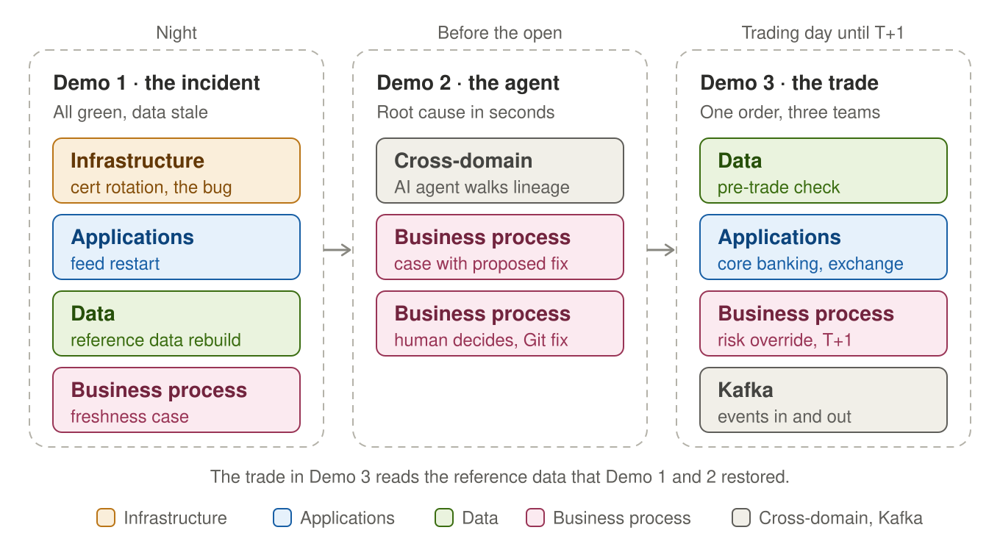
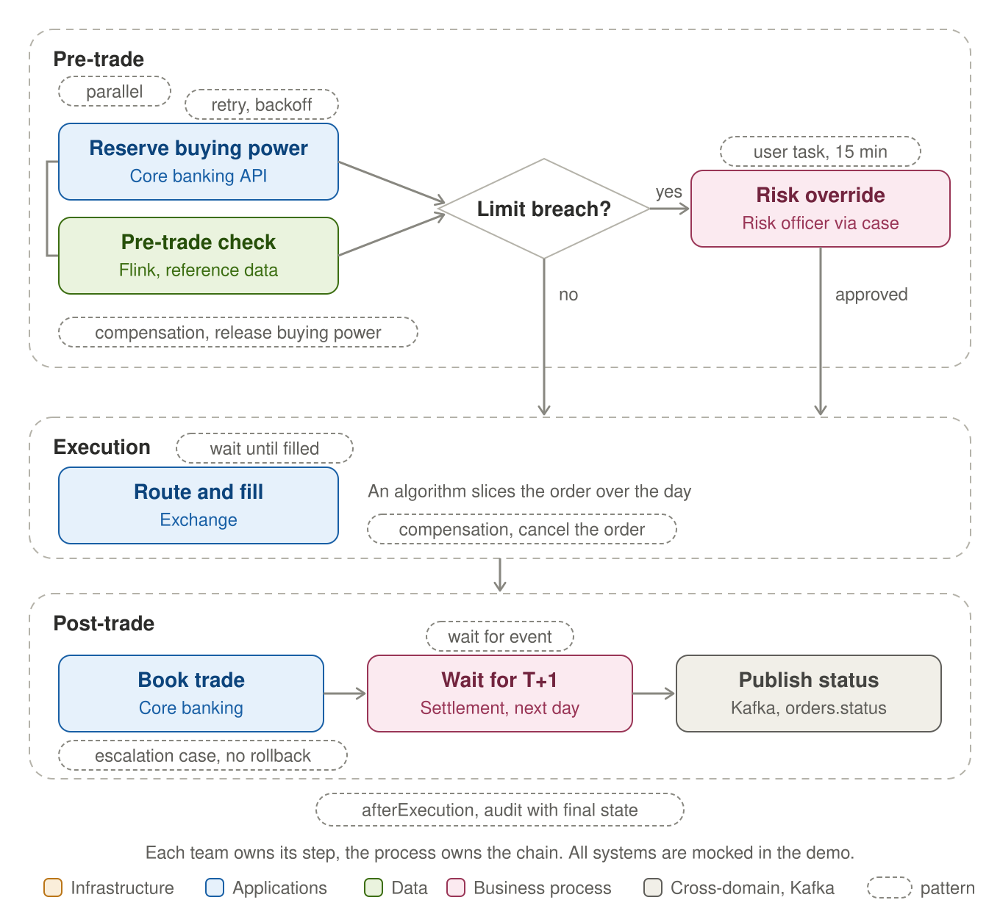

# Unified Orchestration for Financial Services

A Kestra demo that follows a bank from one night into the next trading day, across four domains: infrastructure, applications, data and business processes. Built for architects and technical leaders in banking and other regulated industries.

Maintained by [Kai Waehner](https://www.linkedin.com/in/kaiwaehner), Global Field CTO at Kestra. A personal demo project, not an official Kestra product.

> **Requires Kestra Enterprise Edition.** Assets, freshness triggers, cases and human tasks are EE features.

## The story in 30 seconds

Every night, four teams prepare the reference data (security master, corporate actions) that trading desks need at the open. One night, a hardcoded certificate name breaks the market data feed. Every step reports success. Market data support sees stale data and has no idea why. Finding the cause across four teams takes a morning, and the market is already open.

**Demo 1** traces the incident backwards through asset lineage in a few clicks.
**Demo 2** lets an AI agent do the backward analysis in seconds and propose a fix. A human reviews it and decides.
**Demo 3** moves on to the trading day. Orders that need a workflow arrive as Kafka events, one execution each, and a duplicate runs only once. A standard order goes back to the order management system, a large stock order from a pension fund starts a process. Core banking, risk analytics and the trading platform each own one step, and one process owns the chain from pre-trade through execution to settlement on T+1, including the human override when a risk limit is breached.
**Demo 4** looks at the platform underneath. Flink and Fluss serve every order and Kestra is not in that path, but changing them is a process: a new version of the Flink pre-trade job rolls out with a savepoint, an approval and a rollback, and the reference data is loaded into Apache Fluss with lineage back to the night of Demo 1.

Full story: [docs/story.md](docs/story.md)

## Video walkthrough

Coming soon. Each release (v1, v2, v3) will get its own video here.

## The demos at a glance

Demo 1 and Demo 2 cover the night and the morning before the open. Demo 3 covers the trading day that follows, from the order event to settlement, and its pre-trade check reads the same reference data that Demo 1 and Demo 2 restored. Demo 4 covers the platform underneath, Flink and Fluss, and how changes to it are orchestrated.

In Demo 1 and Demo 2, every flow succeeds, yet the reference data is stale. Only the freshness check sees the outcome. An AI agent walks the chain backwards and proposes a fix, and a human decides.

In Demo 3, one large order runs as a long-running transaction in three phases. Each phase has its own error handling, because what you can undo before the trade is executed differs from what you can undo after it.

More detail, including asset lineage and error handling per phase: [docs/architecture.md](docs/architecture.md)

## The flows

| # | Flow | Namespace | Domain | Team | Trigger |
|---|---|---|---|---|---|
| 1 | `1_deploy_new_cert` | `infra` | infrastructure | platform | manual |
| 2 | `2_rotate_certs` | `infra` | infrastructure | platform | flow trigger after 1 |
| 3 | `3_restart_feed` | `infra` | applications | feed-engineering | flow trigger after 2 |
| 4 | `4_update_reference_data` | `data` | data | reference-data | flow trigger after 3 (Kafka in production) |
| 5 | `5_data_alerts` | `data.support` | business-process | market-data-support | freshness trigger every 5 min |
| 6 | `6_agent_root_cause_analysis` | `company.team` | cross-domain | platform | case action (Demo 2) |
| 7.0 | `7_0_publish_order_events` | `apps.trading` | applications | trading-platform | manual, stands in for the Kafka producers (Demo 3) |
| 7.1 | `7_1_order_events` | `apps.trading` | applications | trading-platform | one execution per order event (Kafka in production, Demo 3) |
| 7.2 | `7_2_large_order` | `apps.trading` | business-process | trading-operations | subflow of 7.1 for large orders, or manual (Demo 3) |
| 7.3 | `7_3_reserve_buying_power` | `apps.core_banking` | applications | core-banking | subflow of 7.2 |
| 7.4 | `7_4_pre_trade_check` | `data.risk` | data | risk-analytics | subflow of 7.2 |
| 7.5 | `7_5_route_order` | `apps.exchange` | applications | trading-platform | subflow of 7.2 |
| 8.0 | `8_0_load_fluss_reference` | `data` | data | reference-data | manual (after reference data in production, Demo 4) |
| 8.1 | `8_1_flink_job_rollout` | `infra` | infrastructure | streaming-platform | manual (Demo 4) |

Assets connect the chain in Demo 1 and Demo 2, from `feed_certificate` (File) to `feedhandler` (External) to `reference_data` (Dataset). Demo 3 and Demo 4 extend that lineage. `8_0_load_fluss_reference` reads `reference_data` and writes `fluss_reference_table` (External, a Fluss primary-key table), `7_4_pre_trade_check` reads that table, and `7_2_large_order` and `7_1_order_events` write the order status to `orders_status` (External, the Kafka topic `orders.status`). `8_1_flink_job_rollout` writes `flink_pre_trade_job` (External, the Flink job).

The bug in Demo 1 is a hardcoded symlink to an old certificate in `2_rotate_certs`. Every flow is green, and only the freshness check sees that the outcome is wrong.

## Quick start

1. Copy `docker-compose.yml`, add your EE license configuration, then run `docker compose up -d` (about 1 to 2 minutes).
2. Follow [docs/setup.md](docs/setup.md) for groups, secrets and flows (about 15 minutes).
3. Run the pre-run checklist and the demos: [docs/demo-script.md](docs/demo-script.md).

## Roadmap

| Release | Scope | Status |
|---|---|---|
| **v1** | Demo 1 and Demo 2, a cross-domain incident chain with asset lineage, cases and AI root cause analysis | ✅ released |
| **v2** | v2 adds Demo 3, a large stock order as business process orchestration with parallel steps, retry with backoff, a gateway, a human override with a timeout, compensation per phase, an escalation case and an audit entry that always runs (BPMN and Camunda-style patterns) | ✅ released |
| **v3** | v3 starts Demo 3 from Kafka order events, with one execution per event and idempotency for at-least-once delivery, and adds Demo 4, operating the streaming platform with a Flink job rollout (savepoint, approval, rollback) and a Fluss table in the lineage | ✅ this release |

## Disclaimer

Demo code with simulated tasks (`echo` commands). Kafka, Flink, Fluss, core banking, the exchange and settlement are mocked. Do not use as-is in production. Secret values are never stored in this repository; only secret names are referenced.

## License

[Apache License 2.0](LICENSE)
