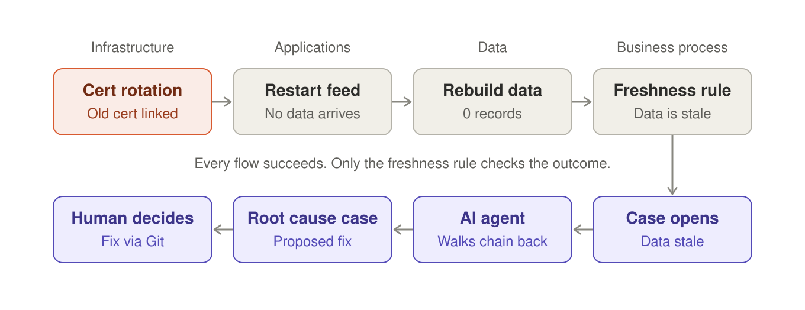

# Unified Orchestration for Financial Services: Pre-Market Readiness Demo

A Kestra demo that shows **one incident traced across four domains**: infrastructure, applications, data and business processes. Built for architects and technical leaders in banking and other regulated industries.

Maintained by [Kai Waehner](https://www.linkedin.com/in/kaiwaehner), Global Field CTO at Kestra. A personal demo project, not an official Kestra product.

> **Requires Kestra Enterprise Edition.** Assets, freshness triggers, cases and human tasks are EE features.

## The story in 30 seconds

Every night, four teams prepare the reference data (security master, corporate actions) that trading desks need at the open. One night, a hardcoded certificate name breaks the market data feed. Every step reports success. Market data support sees stale data and has no idea why. Finding the cause across four teams takes a morning, and the market is already open.

**Demo 1** traces the incident backwards through asset lineage in a few clicks.
**Demo 2** lets an AI agent do the backward analysis in seconds and propose a fix. A human reviews it and decides.

Full story: [docs/story.md](docs/story.md)

## Video walkthrough

Coming soon. Each version (V1, V2, V3) will get its own video here.

## The demo at a glance

Every flow succeeds, yet the reference data is stale. Only the freshness check sees the outcome. An AI agent walks the chain backwards and proposes a fix; a human decides.

More detail, including asset lineage: [docs/architecture.md](docs/architecture.md)

## The flows

| # | Flow | Namespace | Domain | Team | Trigger |
|---|---|---|---|---|---|
| 1 | `1_deploy_new_cert` | `infra` | infrastructure | platform | manual |
| 2 | `2_rotate_certs` | `infra` | infrastructure | platform | flow trigger after 1 |
| 3 | `3_restart_feed` | `infra` | applications | feed-engineering | flow trigger after 2 |
| 4 | `4_update_reference_data` | `data` | data | reference-data | flow trigger after 3 (Kafka in production) |
| 5 | `5_data_alerts` | `data.support` | business-process | market-data-support | freshness trigger every 5 min |
| 6 | `6_agent_root_cause_analysis` | `company.team` | cross-domain | platform | case action (Demo 2) |

**Assets connect the chain:** `feed_certificate` (File) → `feedhandler` (External) → `reference_data` (Dataset).

**The bug:** `2_rotate_certs` hardcodes the symlink to an old certificate. Every flow is green; only the freshness check sees that the outcome is wrong.

## Quick start

1. Copy `docker-compose.yml`, add your EE license configuration, then run `docker compose up -d` (about 1 to 2 minutes).
2. Follow [docs/setup.md](docs/setup.md): groups, secrets, flows (about 15 minutes).
3. Run the pre-run checklist and the demo: [docs/demo-script.md](docs/demo-script.md).

## Roadmap

| Version | Scope | Status |
|---|---|---|
| **V1** | Cross-domain incident chain, asset lineage, cases, AI root cause analysis | ✅ this release |
| **V2** | Business process orchestration: parallel fan-out, retries with backoff, branching, human decision, compensation, SLA escalation, replay from failed task (BPMN/Camunda-style patterns) | planned |
| **V3** | Application orchestration: event-driven apps around Kafka, Flink, Fluss and beyond | planned |

## Disclaimer

Demo code with simulated tasks (`echo` commands). Do not use as-is in production. Secret values are never stored in this repository; only secret names are referenced.

## License

[Apache License 2.0](LICENSE)
