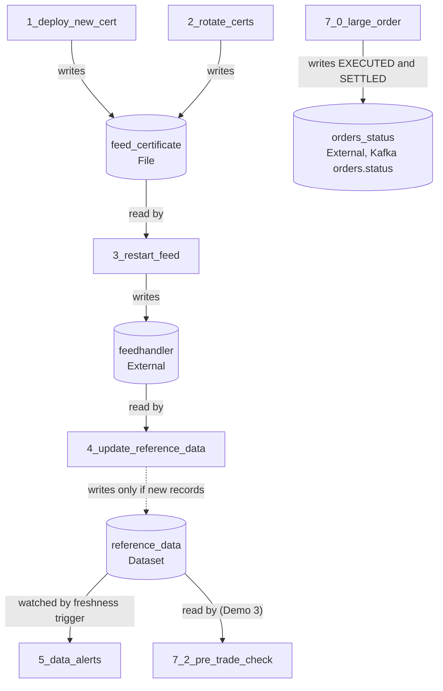
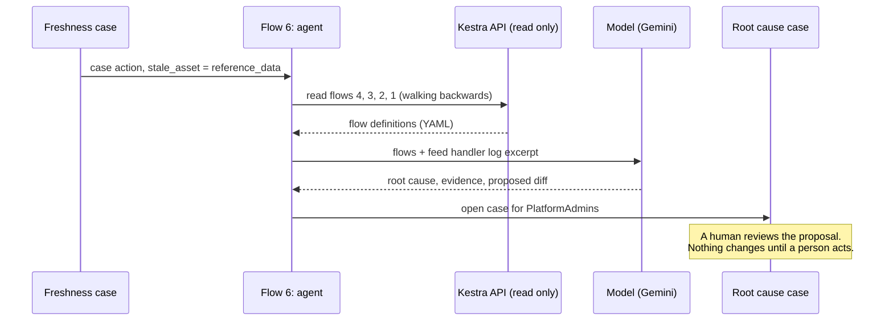

# Architecture

The three demos run on one Kestra instance and share one asset graph. Demo 1 and Demo 2 cover the night and the morning before the open. Demo 3 covers the trading day that follows, and its pre-trade check reads the reference data that the night produced.

## The flow chain and the agent in Demo 1 and Demo 2

Five flows owned by four teams run as a chain. Every flow succeeds, yet the reference data is stale. Only the freshness check in flow 5 looks at the outcome and opens a case. From that case, the cross-domain agent (flow 6) walks the chain backwards, finds the root cause and opens a second case with a proposed fix. A human reviews and decides; the code fix goes through Git.

## Asset lineage

Assets connect the flows. No flow calls another flow's code; each flow only declares what it reads and writes. Kestra builds the lineage graph from these declarations, which is what the analyst (Demo 1) and the agent (Demo 2) follow backwards. Demo 3 hooks into the same graph, because `7_2_pre_trade_check` declares `reference_data` as an input. A stale `reference_data` therefore shows up as an upstream problem of every pre-trade check.

## How the agent investigates

## The large order in Demo 3

`7_0_large_order` is the process. It belongs to trading operations and calls three subflows, each owned by another team in its own namespace. The process does not contain the logic of core banking, risk or the exchange; it only decides the order of the steps and what happens when one of them fails.

The process runs in three phases, each a `Sequential` task with its own `errors` block.

In the pre-trade phase, a `Parallel` task runs `7_1_reserve_buying_power` and `7_2_pre_trade_check` at the same time. Core banking reserves the buying power and retries with exponential backoff (2 seconds, up to 10 seconds, at most 3 attempts). In the demo, the first attempt always times out so the retry is visible. The pre-trade check returns `limit_breach`, and an `If` task acts as the gateway. If the soft limit is breached, the process opens a risk override case with a 5 minute acknowledgement and a 15 minute resolution SLA, and a `Pause` waits for the decision. Without a decision within 15 minutes, the pause fails the order. A rejection fails it too.

In the execution phase, `7_3_route_order` sends the order to the exchange and waits for the fill, with a timeout of 10 minutes in the demo. In production the timeout is the market close, and the fills arrive as execution reports.

In the post-trade phase, the process books the trade, waits for the settlement on T+1 and publishes the status to Kafka. In the demo the wait is a short sleep. In production the execution waits for the settlement event.

A `finally` block writes the audit entry with the order, the execution and its final state, whatever the outcome.

## Error handling per phase

The error handling follows what can still be undone at that point of the trade.

| Phase | Fails when | Error handling | Status on Kafka |
|---|---|---|---|
| Pre-trade | core banking fails after all retries, the check fails, the override is rejected or times out | `release_buying_power` releases the reserved buying power (compensation) | `REJECTED` |
| Execution | routing fails or the order is not filled before the timeout | `cancel_and_release` cancels the open order and releases buying power (compensation), `case_execution` opens a high severity case | `CANCELLED` |
| Post-trade | booking or settlement fails | `case_settlement_fail` opens a critical escalation case for operations, with no rollback because the trade is executed | none |

All subflow calls use `wait: true` and `transmitFailed: true`, so a failure in a team's flow fails the calling task in the process and triggers the error handling of the right phase.

## What is simulated

All external systems are simulated with `echo` commands: the certificate store, the feed handler, the vendor connection and the reference data build. The feed handler log line in the agent prompt is a fixed excerpt. Kafka and Postgres are not required; flow 4 follows the restart instead of a Kafka event.

In Demo 3, core banking, the Flink pre-trade check, the exchange, the booking and the settlement are simulated the same way. The Kafka trigger on `orders.requested` is commented out, so you start `7_0_large_order` manually, and the status messages to `orders.status` are log lines. The risk override uses a `Pause` task, which in production would be a human task assigned to the risk team via RBAC.
