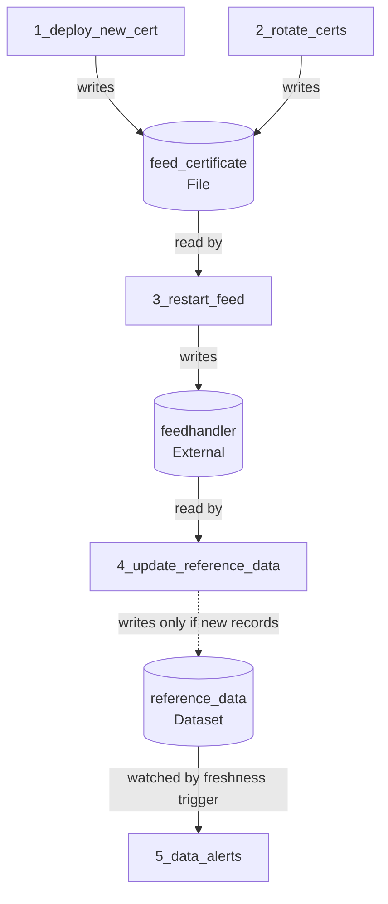
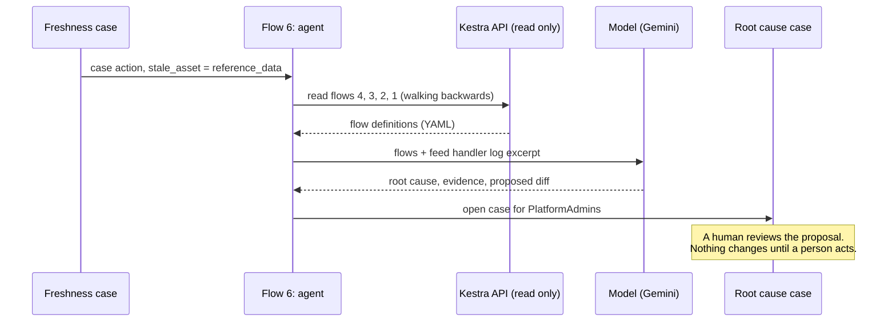

# Architecture (V1)

## Flow chain and agent

Five flows owned by four teams run as a chain. Every flow succeeds, yet the reference data is stale. Only the freshness check in flow 5 looks at the outcome and opens a case. From that case, the cross-domain agent (flow 6) walks the chain backwards, finds the root cause and opens a second case with a proposed fix. A human reviews and decides; the code fix goes through Git.

## Asset lineage

Assets connect the flows. No flow calls another flow's code; each flow only declares what it reads and writes. Kestra builds the lineage graph from these declarations, which is what the analyst (Demo 1) and the agent (Demo 2) follow backwards.

## How the agent investigates

## What is simulated

All external systems are simulated with `echo` commands: the certificate store, the feed handler, the vendor connection and the reference data build. The feed handler log line in the agent prompt is a fixed excerpt. Kafka and Postgres are not required; flow 4 follows the restart instead of a Kafka event.
